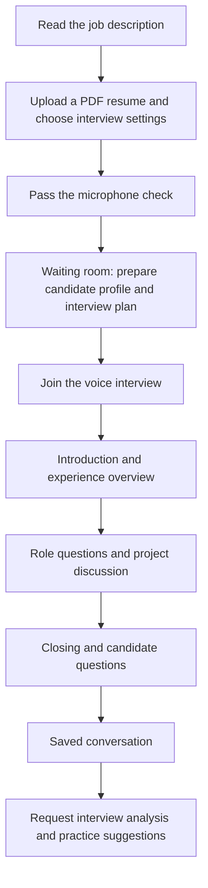
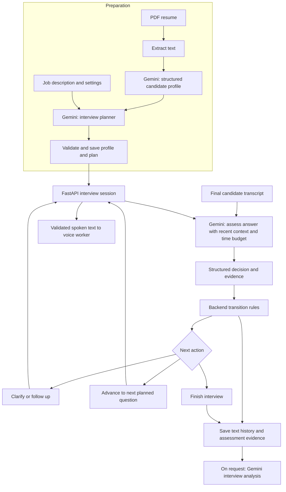
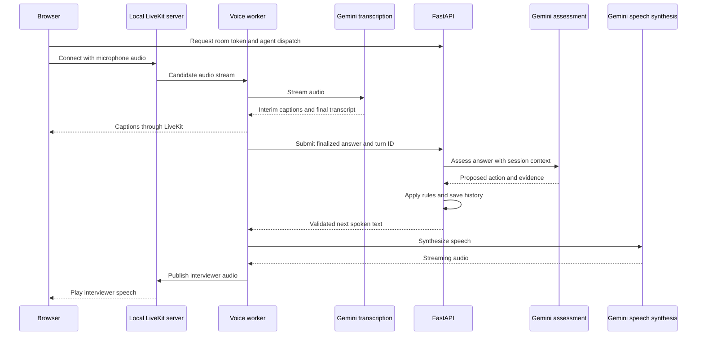

# AI Interviewer

A local voice interview app built with Next.js, FastAPI, LiveKit, and hosted Gemini models. It prepares a structured interview from a resume and job description, adapts questions to the candidate's answers, and saves the conversation for review.

## Interview flow



The job description comes from `sample_data/job_description.txt` and is read-only in the browser. The plan uses the resume, role requirements, seniority, and selected duration. Longer sessions add scenarios and behavioral questions. Introduction and closing collect context without scoring.

## AI agent architecture

The backend owns interview state. Gemini prepares the interview and proposes decisions for each answer; backend rules validate those decisions before the voice agent speaks.



Preparation uses `LLM_MODEL`; live assessment and post-interview analysis use `LIVE_LLM_MODEL`, falling back to `LLM_MODEL`. Follow-ups are limited to two per question and respect section and interview time budgets. Finalized turns use identifiers to prevent duplicate processing. The LiveKit worker handles speech and forwards answers to FastAPI rather than running a separate conversational model.

Preparation artifacts are stored under `data/demo/candidates/`; conversation history is stored under `data/demo/interviews/`. Active sessions live in memory, so restarting the backend or worker requires a new interview. The demo supports one candidate at a time.

## Voice architecture

LiveKit carries WebRTC audio between the browser and a local voice worker. Gemini provides hosted streaming transcription and speech synthesis; FastAPI handles assessment and question progression.



Speech-start events interrupt playback and cancel pending assessment when the candidate resumes talking. The browser provides mute, stop-speaking, and repeat-question controls. Only final transcripts reach assessment. Audio is sent to Gemini; the app saves text and evidence, without recording audio locally. API credentials stay on the server.

## Brief setup

Requires Windows PowerShell, Python 3.12+, Node.js 22.22+, internet access, and a Gemini API key with access to the models configured in `.env.example`.

1. From the project root, copy the configuration if `.env` does not already exist:

   ```powershell
   Copy-Item .env.example .env
   ```

   Set `GEMINI_API_KEY` in `.env` and check the configured text, transcription, and TTS model names. Ensure `sample_data/job_description.txt` contains the job posting.

2. Install dependencies and the local LiveKit server, and check hosted speech access:

   ```powershell
   powershell -ExecutionPolicy Bypass -File scripts/setup-demo.ps1
   ```

   Setup preserves an existing `.env`. Its speech check makes small paid Gemini requests.

3. Start the app:

   ```powershell
   powershell -ExecutionPolicy Bypass -File scripts/start-demo.ps1 -OpenBrowser
   ```

   Open [localhost:5173](http://127.0.0.1:5173). The launcher runs Next.js, FastAPI on port 8000, LiveKit, and the voice worker. Upload a resume, pass the microphone check, prepare, and join. Use headphones to reduce echo.

Keep the launcher terminal open; press Ctrl+C to stop its services. To stop them from another terminal:

```powershell
powershell -ExecutionPolicy Bypass -File scripts/start-demo.ps1 -Action Stop
```
